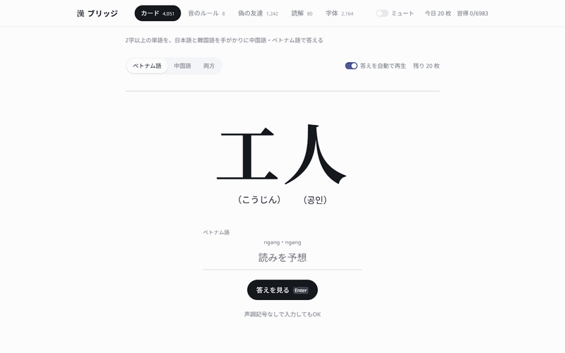
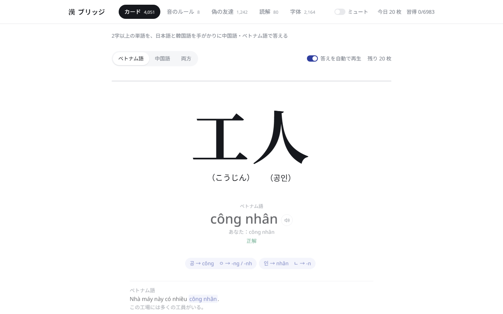
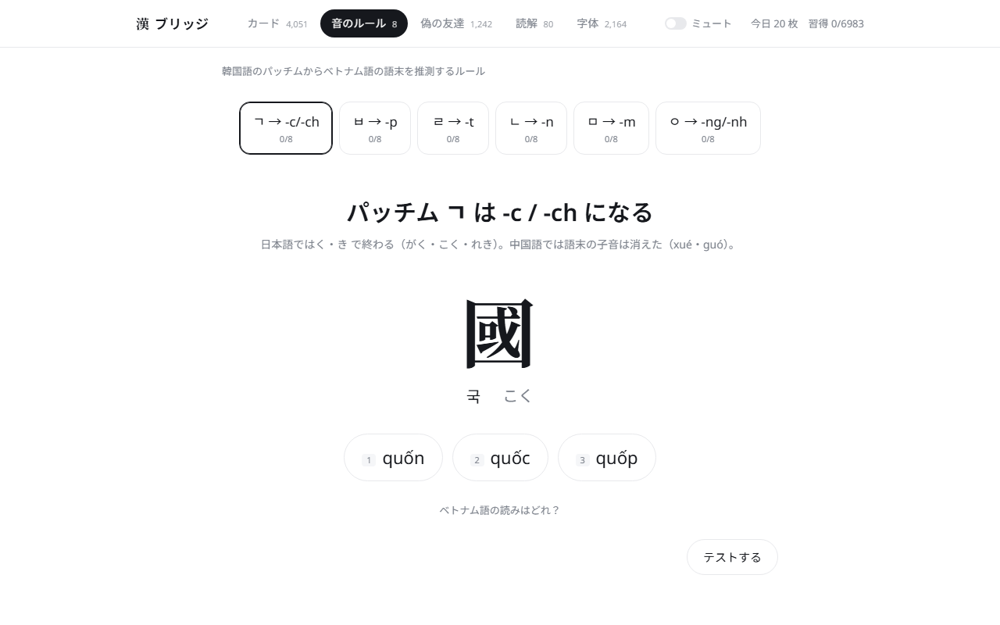
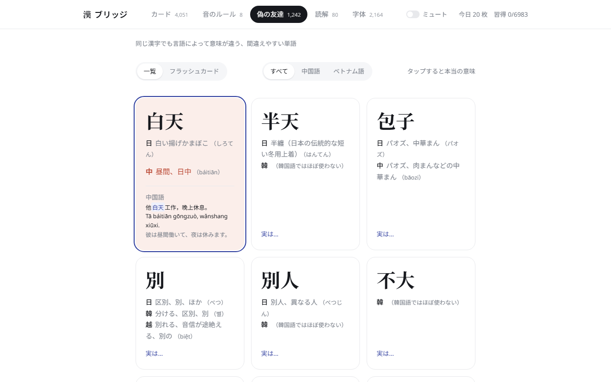
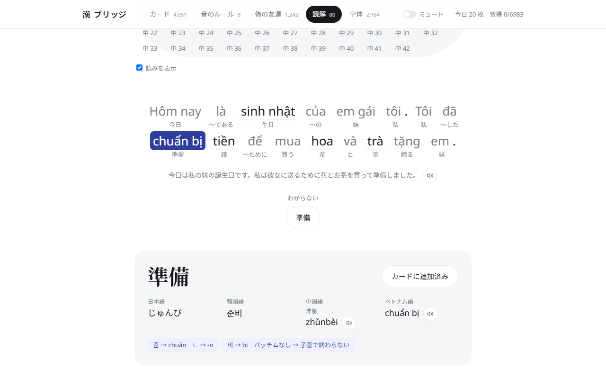
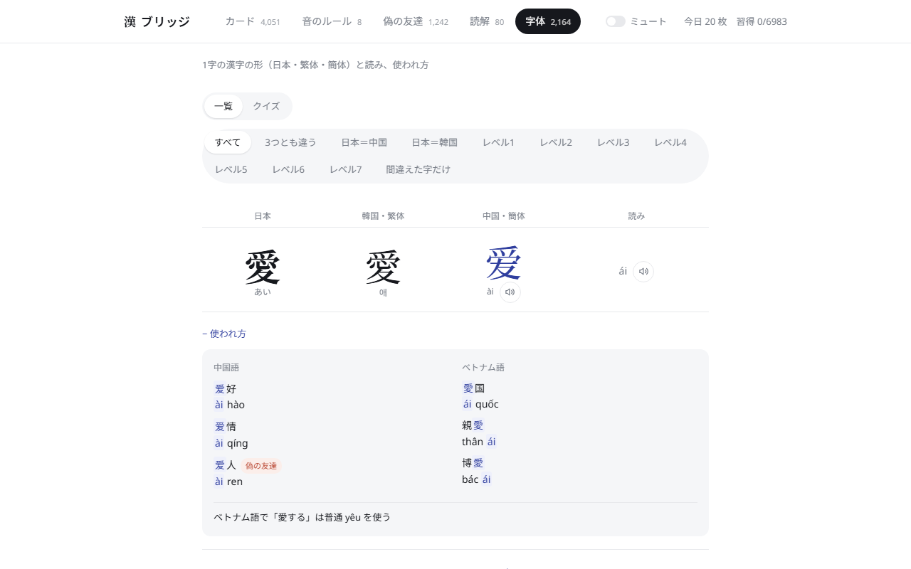
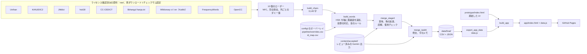
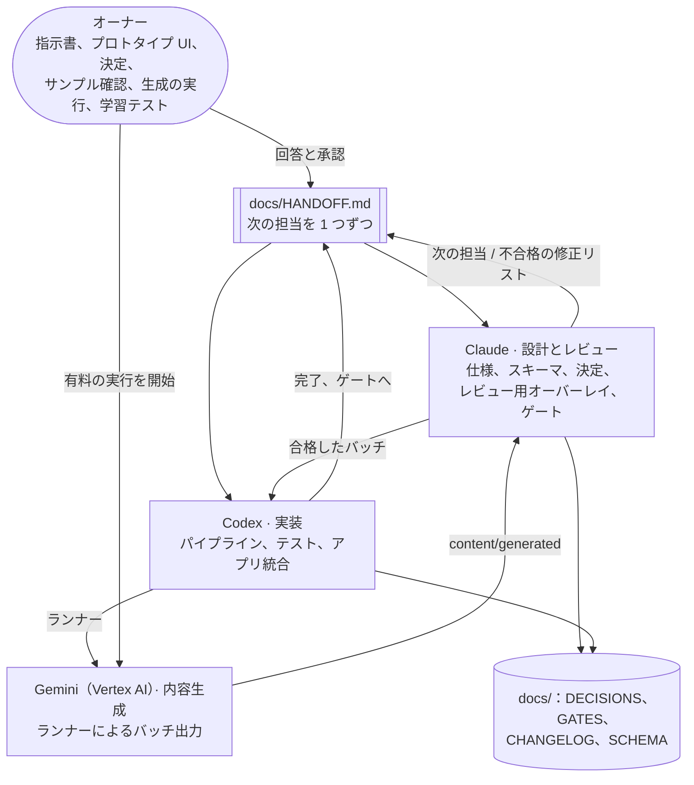

# 漢字ブリッジ · Kanji Bridge

**日本語と韓国語で知っている漢字語を橋にして、中国語とベトナム語を学ぶ。**

[**▶ アプリを開く**](https://hanjejeme2023-oss.github.io/kanji-bridge/) · [English README](README.md)

[](LICENSE)
[](LICENSE-DATA)




學 → 학 / がく / xué / học。中国語とベトナム語の語彙の多くは、日本語・韓国語の漢字語と根が同じである。漢字ブリッジは、日本語と韓国語が読める学習者に、4言語が重なる所（と、ずれる所）を見せる。知っている単語のベトナム語・ピンインを入力するカード、韓国語の終声とベトナム語の語末子音の規則的な対応、意味がずれた「偽の友達」、短い読解、日本・繁体・簡体の字体。

アプリは 1 枚の静的ページ（`app/index.html` + `app/data.js`、6.6 MB）で、ライセンスを確認した辞書から再現可能な Python パイプラインで作っている。インストール不要、ネットがなくてもディスクから動く。UI は日本語。

## 目次
[5つの画面](#5つの画面) · [使い方](#使い方) · [主な数字](#主な数字) · [データの作り方](#データの作り方) · [作り方：3つの AI エージェントと人](#作り方3つの-ai-エージェントと人) · [技術的なポイント](#技術的なポイント) · [データの再構築](#データの再構築) · [既知の課題](#既知の課題) · [データの出典とライセンス](#データの出典とライセンス) · [AI が作った内容](#ai-が作った内容) · [プライバシー](#プライバシー) · [問題の報告](#問題の報告)

## 5つの画面

| | 画面 | 内容 |
|---|---|---|
|  | **カード** | 多字語 6,983 語の間隔反復カード。表は日本語の表記・読みと韓国語。ベトナム語とピンイン（どちらか、または両方）を入力する。声調はヒントとして表示し、判定しない。ベトナム語の Telex 入力に対応。新しいカードは 1 日 20 枚まで。答えの後に音のルールのタグと例文。 |
|  | **音のルール** | 韓国語の終声 → ベトナム語の語末子音（ㄱ → -c/-ch、ㅂ → -p、ㄹ → -t、ㄴ → -n、ㅁ → -m、ㅇ → -ng/-nh）。規則ごとに確認済みの例 4〜8 組、クイズと入力テスト。 |
|  | **偽の友達** | 言語によって意味が違う 1,242 語（手紙は日本語では手紙、中国語ではトイレットペーパー）。罠の印、例文、苦手な語から出るフラッシュカード。 |
|  | **読解** | レベル別の中国語・ベトナム語の短文 80 本。単語をタップすると 4 言語で表示し、タップした語は復習リストに残る。 |
|  | **字体** | 2,164 字：日本・韓国/繁体・簡体の字形、読み、入力クイズ、中国語とベトナム語での「使われ方」。 |

## 使い方

- **Web：** <https://hanjejeme2023-oss.github.io/kanji-bridge/>（PC の Chrome または Edge）
- **オフライン：** このリポジトリをダウンロード（または clone）して `app/index.html` をダブルクリック。`app/` フォルダだけでも動く。ネットがないときはシステムのフォントで表示される。
- 学習記録はブラウザの `localStorage` に、ブラウザごと・アドレスごとに保存される。Web 版とディスク上のファイルは別々の記録になる。画面下の「記録をリセット」で消せる。

## 主な数字

| | |
|---|---|
| 単語 | **12,508**（HSK 3.0 + 頻度の高い漢越語）、すべて辞書の読み付き |
| カード | 多字語 **6,983**（単漢字を含むカード対象は 8,554。単漢字は字体の画面） |
| 漢字 | 表に **3,140**、字体の画面に **2,164** |
| 偽の友達 | **1,242** 語（言語別の意味 4,044） |
| 例 | 例文 **10,367**（中国語はピンイン付き、ベトナム語）、字の使い方メモ **581**、読解 **80** |
| カバー率 | 4 言語がそろう HSK 語：**3,345 / 11,028（30%）**。ライセンスのある資料で届く上限（多くの中国語には日本語・韓国語の同源語がなく、漢越語の読みがあるのは 38%）。HSK 語のピンイン 100%、韓国語 65%、日本語 52%、ベトナム語 38%。 |
| レビュー | ゲートレビュー 17 回（うち 3 回は不合格→修正してから次の段階へ）、理由付きの個別修正 158 件、自動テスト 174 件 + 再構築の決定性テスト |
| AI 生成の費用 | Vertex AI で **$52.76**（上限 $200） |
| 再構築 | 約 4.5 分、何度でもバイト単位で同一 |

**表示速度（R1 の描画修正）。** 長いリスト（字体 2,164 行、偽の友達 1,242 枚）は以前は一度に組み立てていた。今は最初の画面だけすぐ描き、残りは空き時間に少しずつ足す。最終的なページは以前と完全に同じ（旧描画との比較テスト）。

| 操作（ms） | 前：ユーザーの Chrome | 前：headless | 後：headless、最初の画面 | 後：リスト全体がそろうまで |
|---|---|---|---|---|
| 字体「すべて」 | 2,434 | 416 | **10** | 468 |
| 字体クイズ | 998 | 600 | **45** | 625 |
| 偽の友達タブ | 1,013 | 712 | **64** | 911 |
| 偽の友達のタイルを 1 枚開く | 226 | 187 | **30** | — |
| 字体を初めて開く | — | 2,899 | **114** | — |

「前」= app v2（コミット `25e8231`）。headless Chrome、オフライン、同じ PC で 3 回の中央値、2026-11-17 に前後を続けて測定（`tests/app_benchmark.py`）。リストを埋めている間、50 ms を超えるスクリプトの処理はなく（Long Tasks API）、画面は描き続ける。字体・偽の友達を最初に開いたときだけ、何千もの新しい文字のフォントをブラウザが一度だけ準備するため 0.2〜0.4 秒の止まりが数回ある（旧版では同じ処理が 2.9 秒の 1 回の停止の中にあった）。リスト全体がそろう時間は以前とほぼ同じで、変わったのはすぐ操作できること。ユーザーの Chrome の「前」は 2026-11-14 の値。実ブラウザの「後」は公開後に測って追加する。ページの読み込み時間の大半は、表示を止める Google Fonts のスタイルシートによる（[既知の課題](#既知の課題)）。

## データの作り方



`python pipeline/run_all.py` で全部を作り直す。字・読み・ピンイン・ハングル・ベトナム語・HSK レベルは必ず辞書から取り、欠けた値は空のまま報告する（AI が埋めることはない）。詳細：[`pipeline/README.md`](pipeline/README.md)、[`docs/SCHEMA.md`](docs/SCHEMA.md)。

## 作り方：3つの AI エージェントと人

> **下書き — ユーザーの承認待ち。** この節は `docs/DECISIONS.md` にもとづく。プロジェクトのオーナーの承認が必要。



エージェント同士は直接やりとりしない。各セッションは `PROMPT.md` と `docs/HANDOFF.md` を読み、担当を 1 つだけ行い、結果と次の担当を書き戻してコミット（履歴の `[Claude] …` / `[Codex] …`）して止まる。各段階の最後には、報告ではなく証拠を確かめるゲートがある。

**誰が何をしたか**
- **オーナー**は指示書（`PROMPT.md`）を書き、変えてはいけないデータ仕様とプロトタイプ UI を用意した。`docs/DECISIONS.md` にオーナーの決定として記録されたもの：除外する資料・リスクを承知で使う資料（D35）、字の読みの選び方（D37、D39、D50）、ベトナム語資料の探索と確定（D36、D55、D57）、Vertex AI での内容生成とモデル・予算（D54、D58、D60）、アプリを使ってから承認した機能（D20、D67、D71、D76）、ライセンスを決めた公開（D78、D79）。AI の内容をサンプルで自分でも確認し（`TASK5_USER_SAMPLE.md`、`TASK6_USER_SAMPLE.md`、30/30 合格）、有料の生成をすべて自分で開始し、学習者としてアプリを試した。
- **Claude**（Anthropic、Claude Code）は設計とレビュー：スキーマと仕様、記録された決定の大部分とその理由、規則の固定テキスト、内容生成の設計と各パイロット後のプロンプト改訂、AI の誤りを直すレビュー用オーバーレイ、すべてのゲート（`docs/GATES.md`）。オーナーの決定による一度だけの例外として、公開前の修正 R1 も Claude が実装し、別の Claude セッションがそれをレビューした（R2）。
- **Codex**（OpenAI）は実装：ダウンロードとローダー、表の構築、検証、Stage 4 のランナーと最初のプロンプト、マージ、テスト、アプリ統合（`[Codex]` のコミット）。
- **Gemini**（Google、Vertex AI の `gemini-4-argon`）は辞書にない内容を作った：言語別の日本語の意味、偽の友達の判定、読解、使用チェック、例文、字のメモ。すべてのバッチはスクリプトで検証し、レビューしてから採用した。

## 技術的なポイント

- **決定的な再構築。** `run_all.py` は `data/staging/` と `data/final/` を消して作り直す。2 回の再構築は ID まで含めてバイト単位で同一（`tests/test_rebuild.py`）。ID（`c00001`、`w00001`、`p0001`）は `pipeline/id_map.csv` で一度だけ割り当てて再利用する。
- **証拠にもとづくゲート。** 各段階の最後に、数を出し直し、資料と行を突き合わせ、固定の 20 語を確かめるレビューがある。3 回のゲートが不合格になり、具体的な修正を返した（`docs/GATES.md`）。
- **失敗したら止まる検証。** レビュー用オーバーレイの各行は、今の値とちょうど 1 回一致し理由を持たなければビルドが止まる。AI のランナーは構造化出力を項目ごとに検証し（読みは表と一致、ピンインは音節ごとに整列）、採用済みのタスクの再生成を拒否する。
- **列ごとの出所。** `source_ja`、`source_ko`、`source_pinyin`、`source_vi`、`source_level` が読みの出所を記録する。マージは `validate=` を使い `_merge` の件数を記録する。個別の修正は理由付きで `pipeline/overrides.csv`（158 行）に置く。
- **ライセンスの扱い。** 使う前に各資料のライセンスを本人のファイルで確認。継承条件付き（SA）の資料があるのでデータは CC BY-SA 4.0、コードは MIT。除外した資料（ライセンスなし、GPL、非商用、AI 生成）は理由付きで記録。EDRDG の更新手順はスクリプト化（`download.py --refresh --only kanjidic2,jmdict` + `refresh_check.py`）。
- **UI の凍結。** `app/index.html` は手を加えないプロトタイプから `pipeline/build_app.py` で生成する。UI の変更にはすべてオーナーの明示的な承認が必要で、ほかの案は `docs/UX_BACKLOG.md` に入れる。
- **ブラウザでのテスト。** headless Chrome が `app/` のコピーを `file://` と `http://127.0.0.1` で、ネットワークを止めて動かす。17 の画面状態でコンソールエラー 0、「undefined」「NaN」の表示 0。

## データの再構築

Python 3.12 と Git。ダウンロードは約 300 MB。

```
pip install -r pipeline/requirements.txt
python pipeline/download.py        # 記録した URL と SHA-256 から raw/ を再作成
python pipeline/run_all.py         # 約 4.5 分。data/final/ と app/ を作る
python -m unittest discover -s tests -p "test_*.py"
```

ブラウザでの確認（Chrome または Edge、`pip install -r tests/requirements-browser.txt`）：`python docs/review_scripts/stage5_gate_run.py`、`python tests/app_benchmark.py`、`python tests/app_screenshots.py`。KANJIDIC2 と JMdict は 3 か月ごとに更新する（EDRDG のライセンス）。[`pipeline/README.md`](pipeline/README.md) を参照。

## 既知の課題

カバー率
- 4 言語がそろう HSK 語は 30%、ベトナム語の読みがあるのは 38%。これ以上の漢越語の読みを出すライセンス付きの資料はない（D36/D53 で探索）。欠けた値は空のままで、推測しない。
- `hanja.txt` には頻度がないため、韓国語の読みがまれな語のことがある。そうした読みは AI の使用チェックの後、（ ）付きで表示する（D67）。ベトナム語の順序は音節頻度による代用値（ライセンス付きのベトナム語の単語頻度表がないため、D53）。
- 吧 にはベトナム語の読みがない（唯一の資料の値はノムの語で、R1 で外した）。怎 は資料どおり chẩn（普通は chẩm）。

学習者が驚くかもしれない読み（資料由来、記録済み）
- 字の読みを組み合わせたベトナム語が、たまに別の語になる（人為 nhân vị、手紙 thủ chỉ）。見つけた 24 件は外したが、まだ残っている可能性がある。
- 正しい読みがどの資料にもないため、個別修正でも直せない字の代表読み：乾 kiền（「乾いた」の意味は can）、拖 đà、拄 chủ。
- 資料の綴りをそのまま使うので、ある語では *kì*、別の語では *kỳ* と出ることがある（判定では別の文字）。2 つのベトナム語の読みが同数のときは固定の規則に従う（當 đáng/đương、縱、易、液）。
- 同点の候補から来る、余分に正解になる答えがある（調 diào は điều/điệu も、馴 は tuần も正解）。
- 音節の対応の韓国語の「他の読み」に頭音法則の綴りがある（論 논、領 영、露 노、寧 령、異 리）。JMdict の異表記の一致が弱いものがある（蘋果 ひょうか、眼裡 まなうら）。
- 漢越語として追加した語のうち 2 組が、別の表記の HSK 語と重複している（複合/復合、凶悪/兇惡）。
- アプリには出ない既知のデータの誤り：`rules_examples.csv` の 液體 giá thể と 奔 hợp。

AI の内容
- 例文と一部の意味は AI が作り、サンプルでレビューした。誤り率 5% 未満のバッチだけを採用した（例文は 1.2%）ので、誤りは残っている。一部の読解に報道調の語がある。採用済みの意味 1 件（季女）はカードにならない。

アプリ
- Google Fonts のスタイルシートが最初の表示を止めるため、遅い回線ではこれが読み込み時間の大半になる（ユーザーの測定 3.0 秒、headless のオフラインでは約 0.4 秒）。直すには凍結したページの head を変えるので、オーナーの判断を待つ（`docs/UX_BACKLOG.md` #9）。
- 字体と偽の友達は最初の画面の後、残りを裏で足していく。ブラウザの検索（Ctrl+F）が後半の行を見つけられるのは 1〜5 秒後（#10）。
- PC 専用（Chrome または Edge）。スマートフォン向けのレイアウトではない。

公開
- HSK 3.0 の語彙表の著作権の状態ははっきりしない（[NOTICE](NOTICE.md#hsk-provenance)）。

## データの出典とライセンス

- **コード**（`pipeline/`、`tests/`、`docs/review_scripts/`、`.github/`、`app/index.html`、`prototype/index.html`）：[MIT](LICENSE)
- **データ、AI が作った内容、文書**（`data/final/`、`app/data.js`、`content/`、`config/`、`pipeline/id_map.csv`、`pipeline/overrides.csv`、`docs/`、README）：[CC BY-SA 4.0](LICENSE-DATA)（継承条件付きの資料を使うため）

| 資料 | ライセンス | 用途 |
|---|---|---|
| Unihan（Unicode, Inc.） | Unicode License v3 | 字の異体と読み |
| KANJIDIC2、JMdict（EDRDG） | CC BY-SA 4.0 | 日本語の字形と読み |
| ivankra/hsk30 | MIT | HSK 3.0 の語・字・レベル |
| CC-CEDICT（MDBG） | CC BY-SA 4.0 | 簡体字、ピンインの区切り、英語の語釈 |
| libhangul `hanja.txt` | BSD 3-Clause | 韓国語の読みと語 |
| ベトナム語版・英語版 Wiktionary（Kaikki/Wiktextract 経由） | CC BY-SA 4.0 | 漢越語の読み |
| FrequencyWords（OpenSubtitles 2018） | CC BY-SA 4.0 | ベトナム語の頻度の代用値 |
| OpenCC | Apache 2.0 | 日本の字形 ↔ 繁体字の対応 |

This app uses the JMdict and KANJIDIC2 dictionary files. These files are the property of the Electronic Dictionary Research and Development Group, and are used in conformance with the Group's licence. すべての資料は加工している（解析、正規化、マージ、対応付け）。全文の表示：[NOTICE.md](NOTICE.md) と [`licenses/`](licenses/)、ライセンスの記録：[`docs/SOURCES.md`](docs/SOURCES.md)。

## AI が作った内容

Vertex AI の Google Gemini（`gemini-4-argon`、パイロットは `gemini-3.8-flash`）が作ったもの：各語の言語別の日本語の意味、偽の友達の判定、読解 80 本、まれな日本語・韓国語の読みの使用チェック、例文、字の使い方メモ。読み・字・レベルは AI から取らない。すべてのバッチをスクリプトで検証し（構造、読みの完全な一致、ピンインの整列）、サンプルと確信度の低い項目をすべてゲートでレビューし、誤りは理由付きのオーバーレイで直すか再生成し、オーナーもサンプルを確認した。それでも誤りを含むことがある。プロンプト、生の出力、ログ、費用の記録は [`content/`](content/) にある。

## プライバシー

アプリはデータを集めず、何も送信しない。学習記録はブラウザの `localStorage` の中だけにある。Web 版を開くと、普通の Web ページと同じく、ホストの GitHub Pages と Google Fonts（fonts.googleapis.com、fonts.gstatic.com）に IP アドレスやブラウザの情報が届く。ディスクからオフラインで開いた場合、フォントの読み込み（失敗しても表示に影響しない）以外の通信はない。

## 問題の報告

[Issue](https://github.com/hanjejeme2023-oss/kanji-bridge/issues) で、画面、単語または字、何がおかしいか、何を期待したかを書いてほしい（テンプレートあり）。修正は [`docs/RELEASE_PLAN.md`](docs/RELEASE_PLAN.md) §6 の手順で行う：原因の特定、テスト付きの修正、レビュー、再公開。
