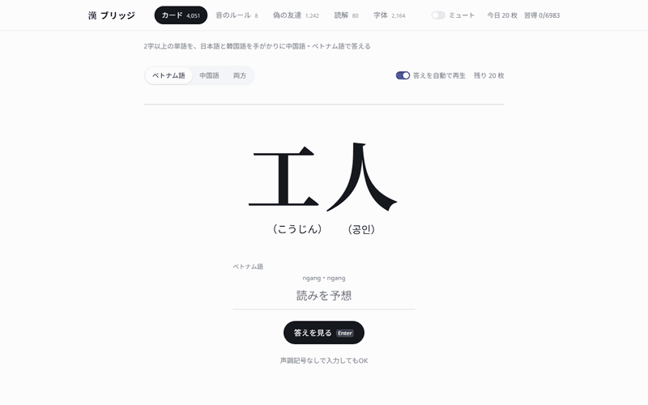
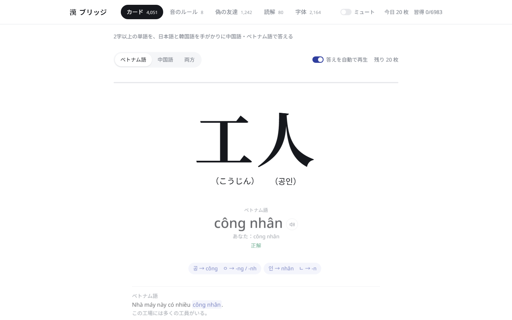
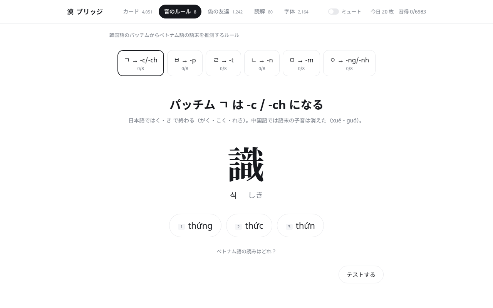
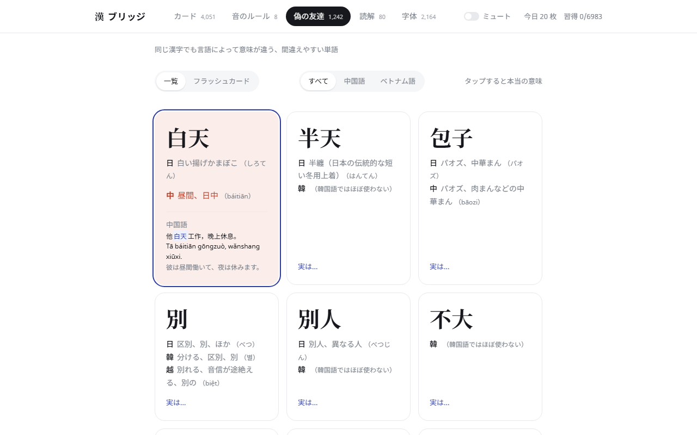
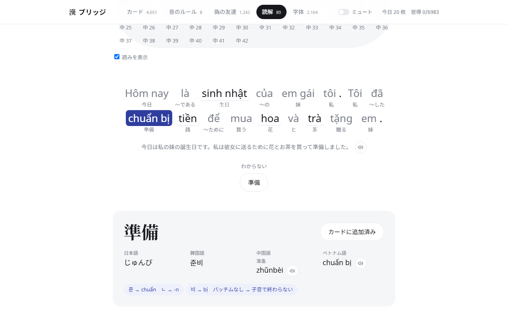
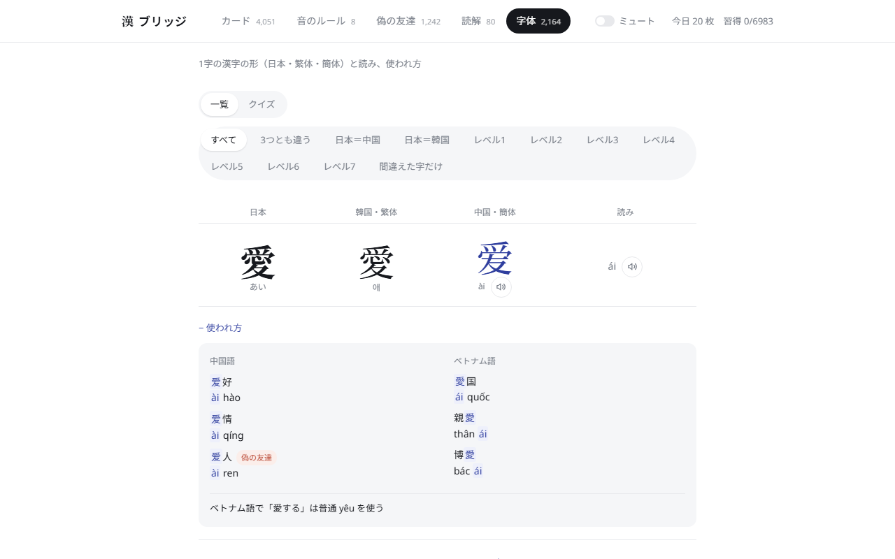
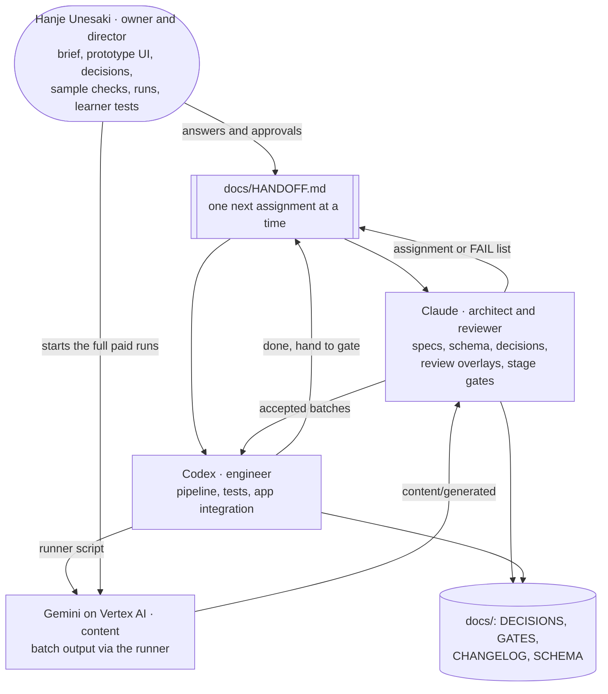

# 漢字ブリッジ · Kanji Bridge

**Learn Chinese and Vietnamese through the Sino-Xenic vocabulary you already know in Japanese and Korean.**

[**▶ Open the app**](https://hanjejeme2023-oss.github.io/kanji-bridge/) · [日本語の README](README.ja.md)

[](LICENSE)
[](LICENSE-DATA)




學 → 학 *hak* / がく *gaku* / 学 xué / học. Most Chinese and Vietnamese vocabulary shares its roots with Japanese and Korean words. Kanji Bridge shows a learner who reads Japanese and Korean where the four languages meet (and where they don't): flashcards that ask for the Vietnamese and/or pinyin reading of a word you already know, the regular sound correspondences between Korean and Vietnamese endings, false friends whose meaning drifted, short reading passages, and the Japanese / traditional / simplified character forms.

It is a single static page (`app/index.html` + `app/data.js`, 6.6 MB) built from licensed dictionaries by a reproducible Python pipeline. It runs from disk without a network connection or install; the UI is in Japanese.

## Contents
[The five views](#the-five-views) · [Try it](#try-it) · [Key numbers](#key-numbers) · [How the data is built](#how-the-data-is-built) · [How it was built: three AI agents and a human](#how-it-was-built-three-ai-agents-and-a-human) · [Engineering highlights](#engineering-highlights) · [Rebuild the data](#rebuild-the-data) · [Known gaps](#known-gaps) · [Data sources and licences](#data-sources-and-licences) · [AI-generated content](#ai-generated-content) · [Privacy](#privacy) · [Reporting a problem](#reporting-a-problem)

## The five views

| | View | What it does |
|---|---|---|
|  | **カード** (cards) | Spaced-repetition cards for 6,983 multi-character words. The front shows the Japanese form and reading and the Korean; you type the Vietnamese and/or pinyin. Tones are shown as hints and not judged; Vietnamese Telex input works. At most 20 new cards a day. After the answer: the sound-rule tags and an example sentence. |
|  | **音のルール** (sound rules) | Korean final consonant → Vietnamese final consonant (ㄱ → -c/-ch, ㅂ → -p, ㄹ → -t, ㄴ → -n, ㅁ → -m, ㅇ → -ng/-nh), each with 4–8 verified example pairs, a quiz and a typing test. |
|  | **偽の友達** (false friends) | 1,242 words whose meaning differs between the languages (手紙 is a *letter* in Japanese but *toilet paper* in Chinese), with the trap marked, example sentences, and flashcards that bring weak words back first. |
|  | **読解** (reading) | 80 short Chinese and Vietnamese passages by level; tap a word to see it in all four languages; tapped words are kept for review. |
|  | **字体** (character forms) | 2,164 characters: Japanese vs Korean/traditional vs simplified forms, readings, a typing quiz, and 「使われ方」 panels with how the character is used in Chinese and Vietnamese words. |

## Try it

- **On the web:** <https://hanjejeme2023-oss.github.io/kanji-bridge/> (Chrome or Edge on a PC).
- **Offline:** download or clone this repository and double-click `app/index.html`. The `app/` folder works on its own (copy it anywhere); without a network the page uses system fonts.
- Progress is stored in your browser (`localStorage`), separately per browser and per address, so the website and the file on disk keep separate progress. 「記録をリセット」 at the foot of the page clears it.

## Key numbers

| | |
|---|---|
| Words | **12,508** (HSK 3.0 + high-frequency Sino-Vietnamese words), each with its dictionary readings |
| Card deck | **6,983** multi-character words (8,554 card-eligible incl. single characters, which live in 字体) |
| Characters | **3,140** in the tables; **2,164** in 字体 |
| False friends | **1,242** entries (4,044 per-language meanings) |
| Examples | **10,367** example sentences (Chinese with pinyin, Vietnamese), **581** character usage notes, **80** passages |
| Coverage | HSK words with all four languages: **3,345 / 11,028 (30%)**. This is the ceiling the licensed sources allow (many Chinese words have no Japanese or Korean cognate, and only 38% have a licensed Hán-Việt reading). Pinyin 100%, Korean 65%, Japanese 52%, Vietnamese 38% of HSK words. |
| Review | 17 logged gate reviews (3 failed and were fixed before the next stage), 158 reasoned one-off overrides, 174 automated tests + a rebuild-determinism test |
| Cost of AI generation | **$52.76** on Vertex AI (ceiling $200) |
| Rebuild | ≈ 4.5 min, byte-identical on every run |

**Speed (R1 render fix).** The long lists (字体 2,164 rows, 偽の友達 1,242 tiles) used to be built in one go. They now draw the first screen at once and fill the rest in small idle-time steps, with exactly the same final page (tested against the old renderer).

| Step (ms) | Before: user's Chrome | Before: headless | After: headless, first screen | After: whole list in place |
|---|---|---|---|---|
| 字体 「すべて」 | 2,434 | 416 | **10** | 468 |
| 字体 quiz | 998 | 600 | **45** | 625 |
| 偽の友達 tab | 1,013 | 712 | **64** | 911 |
| open one 偽の友達 tile | 226 | 187 | **30** | — |
| first 字体 open | n/a | 2,899 | **114** | — |

"Before" = app v2 (commit `25e8231`); headless Chrome, offline, median of 3 runs on the same PC, both columns measured back to back on 2026-11-17 (`tests/app_benchmark.py`). While the list fills, no script step runs longer than 50 ms (Long Tasks API) and the page keeps painting; only the very first 字体 / 偽の友達 open shows a few pauses of 0.2–0.4 s, the browser's one-time font preparation for thousands of new characters, which the old version paid inside one 2.9 s freeze. Filling the whole list takes about as long as before; what changed is that the page responds at once. The user's real-Chrome "before" figures are from 2026-11-14; a real-browser "after" will be added once measured on the live site. Page load is dominated by the blocking Google Fonts stylesheet (see [Known gaps](#known-gaps)).

## How the data is built

```mermaid
flowchart LR
  subgraph S[Licensed sources: raw/, re-downloaded and checksum-locked]
    U[Unihan]
    K2[KANJIDIC2]
    JM[JMdict]
    H[hsk30]
    CE[CC-CEDICT]
    LH[libhangul hanja.txt]
    WV[Wiktionary vi / en via Kaikki]
    FW[FrequencyWords]
    OC[OpenCC]
  end
  S --> L[10 loaders<br/>NFC, strip, per-column dummy values]
  L --> C[build_chars<br/>3,140 characters]
  C --> W[build_words<br/>HSK backbone + VI-only words,<br/>aligned syllables, sound rules]
  OV[(config/ overlays<br/>pipeline/overrides.csv<br/>id_map.csv)] --> W
  W --> M4[merge_stage4<br/>meanings, false friends,<br/>passages, usage checks]
  G[(content/accepted/<br/>reviewed Gemini output)] --> M4
  M4 --> M6[merge_task6<br/>examples, character notes]
  G --> M6
  M6 --> F[(data/final/<br/>CSV + JSON)]
  F --> X[export_app_data<br/>data.js]
  P[prototype/index.html<br/>frozen UI] --> B[build_app]
  X --> B
  B --> A[app/index.html + data.js]
  A --> GP[GitHub Pages]
```



`python pipeline/run_all.py` runs the whole chain. Facts (characters, readings, pinyin, Hangul, Vietnamese, HSK levels) only ever come from the dictionaries; a missing value stays empty and is reported, never filled in by an AI. Details: [`pipeline/README.md`](pipeline/README.md), [`docs/SCHEMA.md`](docs/SCHEMA.md).

## How it was built: three AI agents and a human



The agents never talked to each other: each session read `PROMPT.md` and `docs/HANDOFF.md`, did one assignment, wrote the result and the next assignment back, committed (`[Claude] …` / `[Codex] …` in the history), and stopped. Every stage ended with a gate that checked evidence, not the author's report.

**Who did what**
- **Hanje Unesaki (project owner and director).** A native speaker of Japanese and Korean learning Chinese and Vietnamese, he conceived the app as the tool he needed and planned it with Claude in claude.ai: the brief (`PROMPT.md`), the data spec and the prototype UI were worked out in those conversations and decided by him. He directed the three-agent workflow: he relayed every assignment and prompt between the agents (the prompts drafted with Claude in claude.ai) and ran each step on his own PC. He made the decisions recorded as his in `docs/DECISIONS.md`: which sources to exclude or accept with a known risk (D21, D35), how character readings are chosen (D37, D39, D50), the Vietnamese source search and finalisation (D36, D55, D57), running the content generation on Vertex AI and its model and budget (D54, D58, D60), the app changes he approved beyond the frozen prototype UI (D20, D67, D71, D76), and the public release with its licences (D78, D79). He set up Google Cloud with a budget alert and ran the full paid generation runs himself, with their reruns and the task-6 pilot ($51.82 of the $52.76 total; the runner stops at $200; the first Vertex test, the task 1–4 pilots and their re-pilot were run by Codex, $0.94), checked samples of the AI content as a native speaker (`TASK5_USER_SAMPLE.md`: all 50 random items and Claude's 26 corrections agreed, 13 borderline cases decided; `TASK6_USER_SAMPLE.md`: 30/30 accepted), and tested the app as a learner; his feedback became the v2 features (D71, D76).
- **Claude** (Anthropic, in Claude Code) was the architect and reviewer: the schema and specs, most recorded decisions and their reasons, the static rule text, the content-generation design and the revised prompts after each pilot, review overlays for wrong AI output, and every stage gate (`docs/GATES.md`). As a one-time exception decided by the owner, Claude also implemented the pre-release fix pass R1; a separate Claude session reviewed it (R2). A separate Claude conversation in claude.ai helped the owner plan the project, read each agent's report and write the next prompt.
- **Codex** (OpenAI) was the engineer: the download and loader scripts, the table builds, validators, the Stage 4 runner and its first prompts, the merges, the tests and the app integration (`[Codex]` commits).
- **Gemini** (Google, `gemini-4-argon` on Vertex AI) generated the content that no dictionary has: Japanese meanings per language, false-friend judgments, reading passages, usage checks, example sentences and character notes. Every batch was validated by script and reviewed before it was accepted.

## Engineering highlights

- **Deterministic rebuild.** `run_all.py` deletes and recreates `data/staging/` and `data/final/`; two rebuilds give byte-identical output including IDs (`tests/test_rebuild.py`). IDs (`c00001`, `w00001`, `p0001`) are assigned once in `pipeline/id_map.csv` and reused.
- **Stage gates with evidence.** Each stage ended with a review that re-derived counts, sampled rows against the sources and checked the 20 fixed test words; three gates failed and sent exact fixes back (`docs/GATES.md`).
- **Fail-closed validation.** Every review overlay row must match exactly one current value and carry a reason, or the build stops; the AI runner validates structured output item by item (readings must equal the tables, pinyin aligned syllable by syllable) and refuses to regenerate accepted tasks.
- **Per-field provenance.** `source_ja`, `source_ko`, `source_pinyin`, `source_vi`, `source_level` record where each reading came from; merges use `validate=` and log `_merge` counts; one-off corrections live in `pipeline/overrides.csv` with a reason (158 rows).
- **Licence handling.** Every source's licence was checked from its own file before use; share-alike sources make the dataset CC BY-SA 4.0 while the code stays MIT; excluded sources (no licence, GPL, non-commercial, AI-generated) are logged with reasons; the EDRDG update procedure is scripted (`download.py --refresh --only kanjidic2,jmdict` + `refresh_check.py`).
- **Frozen UI.** `app/index.html` is generated from the untouched prototype by `pipeline/build_app.py`; every change to the UI needed the owner's explicit approval, and other ideas go to `docs/UX_BACKLOG.md`.
- **Browser-tested.** Headless Chrome runs the real app from a copy of `app/`, over `file://` and `http://127.0.0.1`, with the network blocked: 0 console errors and no "undefined"/"NaN" over 17 view states.

## Rebuild the data

Python 3.12 and Git; about 300 MB of downloads.

```
pip install -r pipeline/requirements.txt
python pipeline/download.py        # recreate raw/ from recorded URLs and SHA-256 checksums
python pipeline/run_all.py         # ≈ 4.5 min; writes data/final/ and app/
python -m unittest discover -s tests -p "test_*.py"
```

Browser checks (Chrome or Edge, `pip install -r tests/requirements-browser.txt`): `python docs/review_scripts/stage5_gate_run.py`, `python tests/app_benchmark.py`, `python tests/app_screenshots.py`. The KANJIDIC2 and JMdict data are refreshed every 3 months (EDRDG licence); see [`pipeline/README.md`](pipeline/README.md).

## Known gaps

Coverage
- Only 30% of HSK words have all four languages, and 38% have a Vietnamese reading: no licensed source gives more Hán-Việt word readings (searched in D36/D53). Missing values are left empty, never guessed.
- `hanja.txt` has no frequency, so a Korean reading may be a rare word; such readings are shown in parentheses （ ） after an AI usage check (D67). The Vietnamese order uses a syllable-frequency proxy, because no licensed Vietnamese word-frequency list exists among the sources checked (D53).
- 吧 has no Vietnamese reading (the only source gave a Nôm word, removed in R1). 怎 shows chẩn, as its only source says (chẩm is the usual reading).

Readings that may surprise a learner (source data, known and documented)
- A Vietnamese reading composed from character readings is occasionally a different word (人為 nhân vị, 手紙 thủ chỉ); 24 such cases were removed, more may remain.
- Some character primaries cannot be corrected by an override because the right reading is not in any source: 乾 kiền (the "dry" sense is can), 拖 đà, 拄 chủ.
- Source spellings are kept, so a learner may see *kì* in one word and *kỳ* in another (judged as different letters). Ties between two Vietnamese readings follow a fixed rule (當 đáng/đương, 縱, 易, 液).
- A few extra accepted answers come from tied candidates (調 diào also accepts điều/điệu; 馴 also accepts tuần).
- Some Korean "other readings" in the aligned syllables are initial-sound-law spellings (論 논, 領 영, 露 노, 寧 령, 異 리); a few JMdict variant matches are weak (蘋果 ひょうか, 眼裡 まなうら).
- Two VI-only words duplicate an HSK word in another form (複合/復合, 凶悪/兇惡).
- Known data errors that the app does not show: 液體 giá thể and 奔 hợp in `rules_examples.csv`.

AI content
- Example sentences and some meanings were generated by AI and reviewed in samples; a batch was accepted only below a 5% error rate (the example sentences: 1.2%), so some errors remain. A few passages use press-register words; one accepted task-1 entry (季女) has no card.

App
- The Google Fonts stylesheet blocks the first render, which is most of the page-load time on a slow connection (the user measured 3.0 s; headless offline about 0.4 s). A fix changes the frozen page head, so it waits for the owner's decision (`docs/UX_BACKLOG.md` #9).
- 字体 and 偽の友達 fill the rest of the list in the background after the first screen; the browser's find (Ctrl+F) sees later rows after about 1–5 s (#10).
- PC only (Chrome or Edge); the layout is not designed for phones.

Release
- The HSK 3.0 list's copyright status is unclear (see [NOTICE](NOTICE.md#hsk-provenance)).

## Data sources and licences

- **Code** (`pipeline/`, `tests/`, `docs/review_scripts/`, `.github/`, `app/index.html`, `prototype/index.html`): [MIT](LICENSE).
- **Data, AI-generated content and documentation** (`data/final/`, `app/data.js`, `content/`, `config/`, `pipeline/id_map.csv`, `pipeline/overrides.csv`, `docs/`, the READMEs): [CC BY-SA 4.0](LICENSE-DATA), required by the share-alike sources.

| Source | Licence | Used for |
|---|---|---|
| Unihan (Unicode, Inc.) | Unicode License v3 | character variants and readings |
| KANJIDIC2, JMdict (EDRDG) | CC BY-SA 4.0 | Japanese forms and readings |
| ivankra/hsk30 | MIT | HSK 3.0 words, characters, levels |
| CC-CEDICT (MDBG) | CC BY-SA 4.0 | simplified forms, pinyin boundaries, glosses |
| libhangul `hanja.txt` | BSD 3-Clause | Korean readings and words |
| Vietnamese and English Wiktionary, via Kaikki/Wiktextract | CC BY-SA 4.0 | Hán-Việt readings |
| FrequencyWords (OpenSubtitles 2018) | CC BY-SA 4.0 | Vietnamese frequency proxy |
| OpenCC | Apache 2.0 | Japanese ↔ traditional character mapping |

This app uses the JMdict and KANJIDIC2 dictionary files. These files are the property of the Electronic Dictionary Research and Development Group, and are used in conformance with the Group's licence. All sources were modified (parsed, normalised, merged, aligned). Full notices: [NOTICE.md](NOTICE.md) and [`licenses/`](licenses/); licence log: [`docs/SOURCES.md`](docs/SOURCES.md).

## AI-generated content

Generated by Google Gemini on Vertex AI (`gemini-4-argon`; `gemini-3.8-flash` for pilots): the Japanese meaning of each word in each language, false-friend judgments, the 80 reading passages, usage checks of rare Japanese/Korean readings, example sentences and character usage notes. Readings, characters and levels never come from the AI. Every batch was validated by script (structure, readings copied exactly, pinyin alignment), samples and every low-confidence item were reviewed at the gates, wrong items were corrected by reasoned overlays or regenerated, and the owner checked samples. It may still contain errors. The prompts, raw outputs, logs and cost ledger are in [`content/`](content/).

## Privacy

The app collects no data and sends nothing. Your progress stays in your browser's `localStorage`. Opening the website makes ordinary requests to GitHub Pages (the host) and to Google Fonts (fonts.googleapis.com, fonts.gstatic.com), which receive your IP address and browser details like any web page. Offline from disk, the page makes no request except the font request, which fails silently.

## Reporting a problem

Open an [issue](https://github.com/hanjejeme2023-oss/kanji-bridge/issues) with the view, the word or character, what looked wrong and what you expected (a template is provided). Fixes follow the maintenance workflow in [`docs/RELEASE_PLAN.md`](docs/RELEASE_PLAN.md) §6: root cause, fix with a test, review, redeploy.
